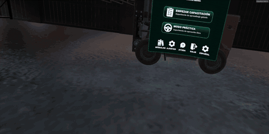
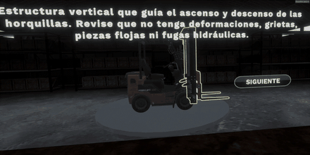
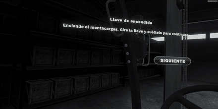
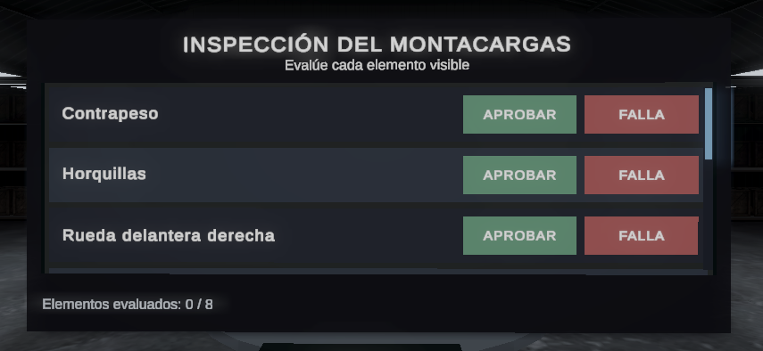
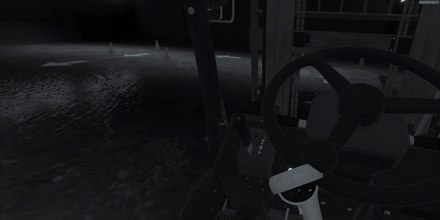
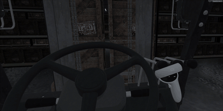
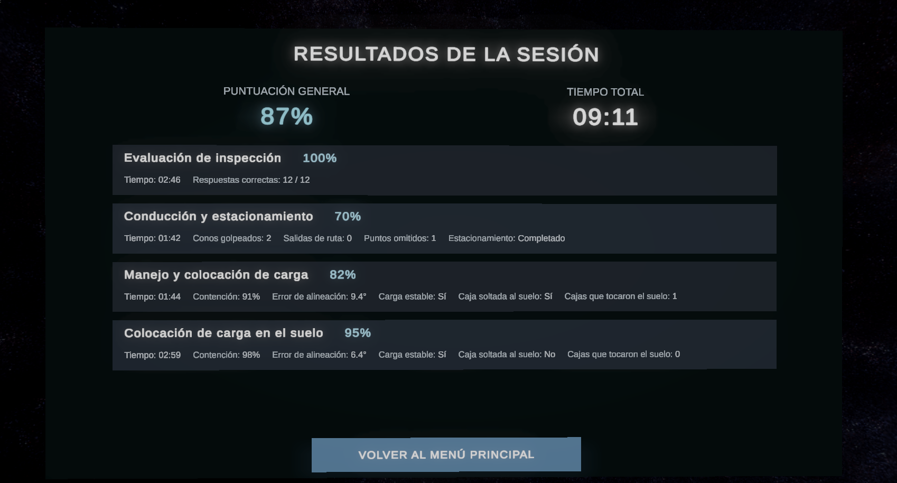

# VR Forklift Training Simulator — Portfolio Showcase

  <strong>Interactive Virtual Reality Forklift Operator Training Simulator</strong> 
  <em>Simulador interactivo en Realidad Virtual para capacitación en operación de montacargas</em>

  <a href="#preview">Preview / Vista previa</a> &nbsp;·&nbsp; <a href="#english">English</a> &nbsp;·&nbsp; <a href="#español">Español</a>

  <code>Unity</code> &nbsp;·&nbsp; <code>C#</code> &nbsp;·&nbsp; <code>Virtual Reality (VR)</code> &nbsp;·&nbsp; <code>Interactive Simulation</code> &nbsp;·&nbsp; <code>Bilingual UI (ES / EN)</code>

> **Portfolio & Confidentiality Notice / Aviso de Portafolio y Confidencialidad**  
> This repository is a **non-code portfolio showcase** describing my development contribution to a project built in collaboration with **Virtual Mind Studio, S.A. de C.V. (VMS)**. All software, source code, 3D assets, technical documentation, and intellectual property belong exclusively to **Virtual Mind Studio**. No proprietary code, algorithms, internal architecture, or confidential information is included here.

---

## Visual Walkthrough / Recorrido Visual

<table>
  <tr>
    <td width="50%" valign="top" align="center">
       
      <strong>Main Menu & Module Selection</strong> · Menú principal y selección de módulos
    </td>
    <td width="50%" valign="top" align="center">
       
      <strong>Exterior Inspection</strong> · Inspección exterior previa a la operación
    </td>
  </tr>
  <tr>
    <td width="50%" valign="top" align="center">
       
      <strong>In-Cabin Controls Inspection</strong> · Inspección interior de controles en cabina
    </td>
    <td width="50%" valign="top" align="center">
       
      <strong>Inspection Evaluation</strong> · Evaluación interactiva de inspección
    </td>
  </tr>
  <tr>
    <td width="50%" valign="top" align="center">
       
      <strong>Driving & Parking Course</strong> · Conducción guiada y estacionamiento
    </td>
    <td width="50%" valign="top" align="center">
       
      <strong>Load & Pallet Handling</strong> · Elevación, traslado y colocación de carga
    </td>
  </tr>
  <tr>
    <td colspan="2" valign="top" align="center">
       
      <strong>Consolidated Session Summary</strong> · Resumen final de desempeño, tiempos y métricas por módulo
    </td>
  </tr>
</table>

---

## English

### Overview

An interactive Virtual Reality (VR) training simulator designed to train operators in the safe inspection, driving, and load-handling procedures of an industrial forklift inside a simulated warehouse environment. The experience runs on standalone VR headsets and guides trainees through structured evaluation modules culminating in an end-of-session performance summary.

### My Role & Contribution

- **Collaboration:** Developer (Practicante Desarrollador) at **Virtual Mind Studio (VMS)** — 2026
- **Scope:** End-to-end software development of the interactive simulator experience.

During this collaboration, I led the hands-on software development and integration of the simulator from the user-facing experience down to day-to-day testing and refinement, covering:

- End-to-end implementation and integration of the forklift driving, mast operation, and in-cabin VR controls.
- Development of the full training progression, individual training modules, free-practice scenario, and results summary flow.
- Integration of real-time user feedback, evaluation metrics, and responsive vehicle/engine audio cues.
- Support for optional physical USB steering wheel and pedal setups alongside native VR interaction.
- Bilingual user interface support (Spanish and English).
- Functional testing, user-experience refinement, and visual/performance optimization for standalone VR headsets.

### User-Facing Features

- **Flexible Training Flow**
  - Complete guided training course from start to finish.
  - Individual selection of specific training modules.
  - Timed free-practice warehouse session.
- **Structured Training Modules**
  - **Pre-Operation Inspection:** Interactive exterior and interior forklift inspection checks followed by an inspection evaluation.
  - **Driving & Parking:** Guided driving course with route tracking, obstacle/cone avoidance, and parking completion checks.
  - **Load Handling & Pallet Placement:** Lifting, transporting, and placing palletized loads in elevated target zones as well as ground-level unloading/placement, evaluating alignment, stability, and safe fork release.
  - **Timed Free-Practice Warehouse Mode:** Open pallet-placement session under time constraints with active pedestrian safety awareness.
- **Realistic In-Cabin Controls**
  - Hands-on VR interaction with the ignition key, forward/neutral/reverse gear selector, steering wheel, and hydraulic levers for mast elevation, tilt, and side-shift.
  - Optional compatibility with external USB steering wheels and pedals for physical simulator rigs.
- **Evaluation & Session Summary**
  - Per-activity scoring, elapsed time tracking, and specific operational safety metrics.
  - Consolidated end-of-session results screen displaying overall performance and per-module breakdowns.
- **Bilingual Interface**
  - Full Spanish and English interface support for training instructions, menus, and evaluation feedback.

---

## Español

### Descripción general

Simulador interactivo de capacitación en Realidad Virtual (VR) orientado a entrenar la operación segura de un montacargas dentro de un entorno de almacén simulado. Diseñado para visores VR autónomos, organiza el aprendizaje en módulos prácticos de inspección, conducción y manipulación de carga, presentando un resumen consolidado de desempeño al finalizar cada sesión.

### Mi rol y participación

- **Colaboración:** Practicante Desarrollador en **Virtual Mind Studio (VMS)** — 2026
- **Alcance:** Desarrollo integral del software y de la experiencia interactiva del simulador.

Durante mi participación estuve a cargo del desarrollo e integración de las funcionalidades del producto, abarcando:

- Desarrollo e integración de la conducción del montacargas, operación del mástil e interacciones físicas en cabina en VR.
- Implementación del flujo completo de entrenamiento, módulos individuales de capacitación, modo de práctica libre y pantalla de resultados finales.
- Integración de retroalimentación en tiempo real, métricas de evaluación visibles al usuario y audio reactivo del vehículo.
- Compatibilidad opcional con volante y pedales físicos por USB de forma complementaria a los controles VR.
- Soporte de interfaz bilingüe (español e inglés).
- Pruebas funcionales, refinamiento de la experiencia de usuario y optimización visual y de rendimiento para visores VR autónomos.

### Funcionalidades visibles al usuario

- **Flujo de entrenamiento flexible**
  - Recorrido completo de capacitación de principio a fin.
  - Selección individual de módulos específicos.
  - Sesión libre cronometrada en almacén.
- **Módulos de capacitación**
  - **Inspección previa a la operación:** Revisión interactiva del exterior e interior del montacargas con etapa de evaluación.
  - **Conducción y estacionamiento:** Recorrido guiado con seguimiento de ruta, detección de contactos con obstáculos/conos y verificación de estacionamiento.
  - **Manejo y colocación de carga:** Elevación, traslado y colocación de pallets tanto en zonas objetivo como a nivel de suelo, evaluando alineación, estabilidad y liberación segura de las horquillas.
  - **Modo de práctica libre cronometrado:** Colocación continua de cargas en estanterías bajo límite de tiempo, incorporando prevención de incidentes con peatones en el almacén.
- **Controles interactivos en cabina**
  - Operación directa en VR de la llave de encendido, selector de marcha (avance, neutral y reversa), volante y palancas hidráulicas para elevación, inclinación y desplazamiento lateral del mástil.
  - Compatibilidad opcional con volante y pedales externos por USB para configuraciones con cabina física.
- **Evaluación y resumen de sesión**
  - Registro de puntuación, duración y métricas específicas de seguridad y desempeño por actividad.
  - Pantalla de resultados acumulados al concluir la ruta con el desglose general de la sesión.
- **Interfaz bilingüe**
  - Interfaz y retroalimentación disponibles en español e inglés.

---

### Intellectual Property & Confidentiality / Propiedad Intelectual y Confidencialidad

All software, source code, algorithms, 3D models, documentation, and related intellectual property of this project are the exclusive property of **Virtual Mind Studio, S.A. de C.V. (VMS)**. This entry is shared solely as a general personal portfolio reference limited to high-level project descriptions and user-visible functionalities, in compliance with the signed collaboration and confidentiality agreements.

Todo el software, código fuente, algoritmos, modelos 3D, documentación y propiedad intelectual de este proyecto son propiedad exclusiva de **Virtual Mind Studio, S.A. de C.V. (VMS)**. Esta entrada se publica únicamente como referencia general de portafolio personal limitada a descripciones generales del proyecto y funcionalidades visibles al usuario, en cumplimiento con los acuerdos de colaboración y confidencialidad firmados.
